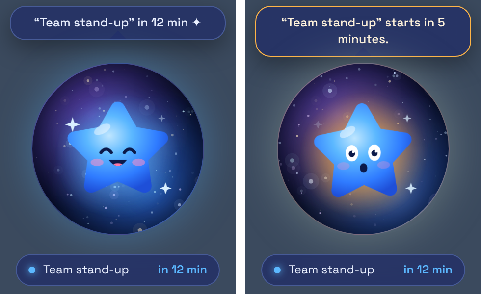
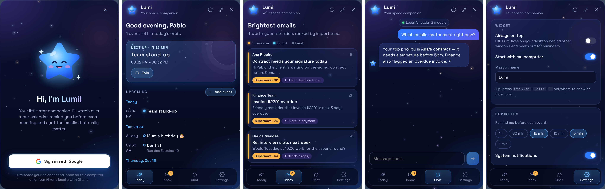

# ✦ Lumi — your space companion

Lumi is a little blue star that lives on your Windows or Mac desktop. It watches your **Google Calendar**, reminds you before every meeting, highlights the **Gmail** messages that actually matter, and chats with you through an AI agent that runs **entirely on your computer** (Ollama).





- **Desktop widget:** a frameless, transparent window that sits on the desktop (or always on top), lives in the tray/menu bar and starts with your computer.
- **Mascot:** Lumi has moods. Idle, happy, *alert* (shakes and glows orange before a meeting), thinking (while the agent works) and asleep (only when the computer is idle). Her eyes are open by default, day or night; the closed "^ ^" eyes appear only for a moment of delight or a yawn.
- **A star that feels alive:** she is never still. She smiles, hops, waves, spins, hums, stretches and looks around on her own; falls asleep (closed eyes, floating "Zzz") when you stop using the computer and stretches when you come back; and **dances to the beat** when music is playing on the computer (see below).
- **Sign in with Google:** one login gives access to Calendar and Gmail. It uses OAuth with PKCE and a loopback redirect, and tokens are encrypted with the OS keychain (`safeStorage`).
- **Reminders:** configurable lead times (default 15 and 5 min). Lumi peeks out in front of your windows and shows a system notification.
- **Important emails:** a heuristic score (Gmail "Important", starred, personal, direct-to-you, deadline/payment/meeting keywords in EN + PT, newsletter/promo penalties), blended with an optional local-AI triage.
- **Local agent:** chat in English or Portuguese. Tools: list events, create event, get important emails, search Gmail, search news and Hacker News, read a website, and **list / create / change / pause / delete routines** (so you can say "create a routine with daily AI news at 8am" in Chat). Creating an event and every routine change **always asks you to confirm first**.
- **Routines and News:** daily jobs she does by herself (a news search, developer articles, or a website to watch for new posts) whose results land in a **News** tab, one click away from the article. See [Routines and News](#routines-and-news).
- **Calendar tab:** a full month view with previous / next / today navigation. Each day shows dots for its events, and selecting a day lists them underneath. Multi-day events appear on every day they cover. Weeks start on Monday.
- **Widget views:** when shrunk, the widget can show the star in a circle (default), a browsable **monthly calendar** or a **daily agenda**. Reminders always appear. Choose it in Settings → Widget.
- **Widget and panel size:** Settings → Widget has two separate sizes (Normal, Smaller 85%, Small 70%, Tiny 60%): "Widget size (shrunk)" for the small widget and "Panel size (expanded)" for the open panel. For example, keep the widget at Tiny and open the panel at Normal; shrinking the panel goes back to the Tiny widget. Her eyes still follow the cursor correctly at any size.
- **Tray mode:** right-click the shrunk widget and choose "Minimize to tray". The tray icon menu also has "Minimize to tray" (hides the widget) and "Start in the tray" (also in Settings → Widget), which starts Lumi hidden. Click the tray icon, or press Ctrl/Cmd+Shift+L, to bring her back. On Windows the icon may sit under the hidden icons (^) until you drag it onto the taskbar.
- **Morning briefing:** once a day after a time you choose (default 08:00), Lumi summarises today's events and your important emails in a card, a speech bubble and a notification. Preview it any time in Settings.
- **Focus timer:** start a 15 / 25 / 45 / 60 minute session from the Today tab. Lumi shows the countdown, and reminders more than 5 minutes away are held back and shown when it ends (one "While you were busy" notice if several came due). You get a notification when it is done.
- **Draft replies:** in the Inbox, "Draft reply" writes a reply with your local model (in the email's language, optionally following a one-line instruction). You edit it and save it to **Gmail Drafts**. Lumi never sends email.
- **Email → event:** "Make event" looks for a meeting or deadline in an email and opens a prefilled form. You confirm before anything is created.
- **Add events from the calendar:** select a day (or double-click it) and use "Add event".
- **Voice input:** click the microphone in Chat and speak. Transcription runs locally with Whisper (see below).
- **Shapes, skins and accessories:** pick her body from four star shapes (star, chubby, sparkle, six-point) or space objects (ringed planet, Earth, Moon, Sun, comet), five colour presets or **any colour you like** with a Photoshop-style picker (they re-theme the whole app), and mix and match 22 accessories by spot: **head** (party hat, crown, wizard hat, top hat, halo, flower, cat ears, antenna, bow, space helmet, Santa hat, witch hat, beanie), **ears** (headphones), **eyes** (glasses, sunglasses, monocle), **neck** (scarf, bow tie) **face** (mustache) and **prop** (umbrella). One accessory per spot, different spots combine. Settings → Appearance has a live preview.
- **Models per task:** use a small model for email triage and a larger one for writing. Settings → Local AI.
- **The AI only runs when you want it:** the local AI is off when Lumi opens. Click **Start AI** in the Chat tab before chatting, and **Stop AI** to unload the model and stop Ollama so nothing keeps running in the background. See [Turning the local AI on and off](#turning-the-local-ai-on-and-off).
- **Answer assignments into a Google Doc:** attach a `.docx`, `.pdf`, `.txt` or `.md` file of questions in Chat. Lumi finds the questions, researches real sources, writes academic answers and saves them as a Google Doc with in-text citations and a reference list in ABNT or APA (see below).

## Quick start

```bash
npm install
cp .env.example .env        # then fill in your Google OAuth client (see below)
npm run dev                 # Vite + Electron with hot reload for the UI
```

To work on the UI only, with sample data and no Google or Ollama needed, run `npm run preview:ui` and open http://localhost:5173. Add `?signedIn=0` to see the login screen, `?ai=off` to see Chat with the local AI off, `?reminder=1` to see a reminder, or `?view=month` / `?view=day` to preview the calendar widget views.

## 1. Google Cloud setup (about 5 minutes)

1. Open https://console.cloud.google.com and create a project (e.g. "Lumi").
2. **APIs & Services → Library**: enable **Google Calendar API**, **Gmail API** and **Google Docs API**.
3. **APIs & Services → OAuth consent screen**: choose *External*, fill in the app name and your email, and add these scopes:
   `openid`, `email`, `profile`, `.../auth/calendar.events`, `.../auth/gmail.readonly`, `.../auth/gmail.compose` (draft replies), `.../auth/documents`.
   While the app is in *Testing*, add your own Google account (and any testers) under **Test users**.
4. **APIs & Services → Credentials → Create credentials → OAuth client ID** → application type **Desktop app**.
5. Then do one of these:
   - copy the Client ID and Secret into `.env`, or
   - download the JSON and save it as `google-oauth.json` in the project root. It is bundled into installers automatically, and it can also go in the app's user-data folder.

> If you signed in before a scope was added (Docs, or Gmail drafts), sign out in Settings and sign in again so Google asks for the new permission. Lumi tells you when this is needed.

> Gmail's `gmail.readonly` is a *restricted* scope. Testing mode works for up to 100 test users. Publishing to the general public needs Google's verification and a security assessment.

## 2. Ollama setup (the local AI)

1. Install Ollama from https://ollama.com and make sure it is running.
2. Pull a model that supports **tool calling**:
   ```bash
   ollama pull qwen2.5:7b      # default
   # or: ollama pull llama3.1:8b
   ```
3. In Lumi → Settings you can pick any installed model or change the server URL.

### Turning the local AI on and off

The local AI is **off** when Lumi opens, so Ollama does not run in the background while you are not using it.

- **Start AI** (Chat tab, next to the status pill) starts `ollama serve` when it is installed but stopped. With "Install the local AI automatically" on, a missing Ollama or model is set up first (see [The local AI sets itself up](#the-local-ai-sets-itself-up)). Until the AI is on, the message box, suggestions and file button in Chat are disabled.
- **Stop AI** unloads every loaded model (this ends Ollama's runner processes and frees their memory) and stops the server Lumi started. A server you started yourself (or that an older Lumi left running) keeps running, with its model unloaded, and Chat tells you so.
- **Quitting Lumi** stops the server Lumi started in the same way.
- Settings → Local AI (Ollama) → **"Start the AI when Lumi opens"** (off by default) brings back the old behaviour of starting it a few seconds after Lumi opens.
- "Draft reply" and "Make event" in the Inbox are explicit AI actions, so they start the AI by themselves when you click them (installing it first, like Start AI). The Chat status pill follows along.
- Answering a file of questions needs the AI on, like chatting.
- While the AI is off, the background AI features quietly fall back: email triage uses only the heuristic score, news routines use the newest items without a summary, and an instructions routine is shown as a problem ("The local AI is off") until the AI is on at its next run. Quick capture only uses the AI if it is already on.

Only a local server URL is ever started or stopped. If Ollama is off, Calendar, Gmail, reminders and the heuristic email ranking still work. Only the chat and the AI features need the model.

## A star that feels alive

**Lively eyes.** Her pupils follow your mouse cursor **anywhere on the screen** (the main process reports the cursor position, since a window only sees the mouse inside itself), widen a little when the cursor comes close, and stare straight ahead during a reminder. When the mouse rests for a few seconds her eyes wander on their own: quick glances left and right, up and down, now and then back toward the cursor, plus tiny involuntary movements. She blinks at random moments, sometimes twice in a row. Turn the cursor tracking off in Settings → Life → "Eyes follow the mouse" (she still wanders and blinks).

**Reactions to the mouse.** Pass the mouse over her and she answers, and the more you do it the more she reacts:

- passing over her makes her **giggle** (laughing eyes and mouth, a little shaking);
- several quick passes in a row (within about 14 seconds) escalate: she narrows her eyes with fierce eyebrows, fixes her gaze on the cursor and **tries to bite it**, lunging at it with her mouth open three times;
- moving the mouse **slowly** over her counts as petting: she leans into the cursor, closes her eyes happily, purrs and little hearts float up, for as long as you keep going;
- the movement is deliberately smooth: the direction she leans fades out as the mouse crosses her centre (so she never twitches), reactions build up from rest on a spring instead of starting with a jolt, and the jaw snaps and the giggle follow eased curves with no sharp corners;
- she forgets your passes after a while, and says something fitting in her speech bubble. Turn it off in Settings → Life → "React when I pet her".

**Spontaneous actions.** Every few seconds Lumi picks something to do: smile, hop, look left and right, wave, wiggle, twinkle, hum (with music notes), stretch, peek, spin or cheer. She never repeats the same action twice in a row and stays calm (no random actions) while a reminder, the chat agent or a focus session is active. Small avatars (the chat) stay still.

**Smooth transitions.** Nothing snaps. The body movement (floating, breathing, bouncing, shaking, dancing) comes from one motion engine that blends poses with weights gliding toward the current state, so falling asleep, waking up and starting or stopping a dance are crossfades. Facial expressions are all drawn at once and faded in and out, the halo colour and glow ease between moods, and music notes and "Zzz" fade in and out. A spontaneous action is never cut short: if something important happens mid-action she finishes it (every action starts and ends at rest) and only the next one is held back.

**Sleeping.** After the keyboard and mouse have been idle for a few minutes (default 3) she falls asleep, and wakes with a yawn and a stretch when you are back. Idle time comes from the operating system. Playing music wakes her up to dance, and moving the mouse wakes her up immediately.

**Dancing to music.** Lumi listens to what the computer is playing (the system's audio output, "loopback" capture) and works out whether it is music and at what tempo:

- It analyses short chunks of audio **in memory only**. Nothing is recorded, saved or sent anywhere, and only the audio track is requested (the video track is dropped immediately).
- Detection needs a clear, steady beat and takes about 5 seconds to lock on. Speech, notification sounds and videos without a beat are ignored. Very ambient or beat-less music will not trigger it.
- The dance is posed on every animation frame from the detected beat clock, so she bounces, sways, hops and twirls **on the beat** and follows tempo changes. Tempos above 150 BPM are danced at half-time so she does not look frantic. The moves change every four beats, ending with a twirl.
- Her bubble shows the detected tempo (for example "♪ 128 BPM").
- Settings → Life lets you turn each behaviour off, change the sleep delay, and shows whether music detection is listening or unavailable.
- **Platform notes:** works on Windows out of the box. macOS 13+ may ask for Screen Recording permission (Electron's system-audio capture requires it) and Linux needs PulseAudio/PipeWire. If capture is not possible the status in Settings says so and everything else keeps working.
- With "reduce motion" enabled in the OS, the spontaneous actions and dance are skipped.

Browser preview (`npm run preview:ui`) extras: `?gallery=1` shows every shape and accessory (add `&skin=sunset` or `&mood=happy`), `?shape=planet&acc=wizard,sunglasses` previews a look, `?skin=custom&color=22c55e` a custom colour, `?update=ready|available|downloading|error` the update banner and card, and for inspecting the animations: `?sleep=1` (start asleep), `?mouse=200,60` (pin the cursor position the eyes look at), `?reaction=giggle|purr|bite` (pin a mouse reaction), `?music=1` (fake 120 BPM music) and `?action=wave` (pin one action: `smile`, `hop`, `look`, `wave`, `spin`, `wiggle`, `stretch`, `twinkle`, `hum`, `peek`, `cheer`, `wake`). Also: `?dnd=fullscreen|meeting|manual` (quiet mode), `?weather=rain|snow|hot|cold|fog|thunder|clear|night|off` and `?lat=-23` (weather and hemisphere), `?today=2026-12-24` (pretend it is another date, for seasonal looks), `?system=lock-screen|unlock-screen|suspend|resume|on-ac|on-battery` (a system reaction) and `#quick` for the quick-capture window.

## Performance and battery

Lumi is meant to be light on a laptop. The details are in the sections below; this is how to check them.

**Measuring.** Start the app with `LUMI_PERF=1` (for example `LUMI_PERF=1 npm run dev`, or `$env:LUMI_PERF=1` in PowerShell; use `LUMI_PERF=detail` for a per-process list; `0`, `false` or `off` keep it off) and it prints the CPU use of the window (renderer), the GPU process and the main process every 5 seconds, in percent of one core, together with the **memory** (MB, private bytes) of each of those, of everything else (`other`) and the total. It is a development aid and does nothing otherwise. `npx electron scripts/perf-measure.cjs` (with `npm run preview:ui` running) measures the widget in five situations (idle, covered, asleep, dancing, panel open) and prints a table; `MAC_LIKE=1` makes it use the macOS window policy.

**Memory.** The big consumers are, in this order: the Ollama model (a separate program, usually several GB while loaded), the speech model, and the Electron processes (window, GPU, main). What Lumi does about it:
- **Low-memory Chromium set (Windows).** The biggest saving (`electron/memoryFlags.ts`, applied before the app is ready): software rendering instead of the GPU, Chromium's low-end-device mode, and the network, audio, video-capture and GPU work running **inside the main process** instead of in four separate processes (network, audio, video capture and GPU). Measured with `LUMI_PERF=1` on the real app with the widget idle, the total goes from about **495 MB to about 162 MB** (GPU process 220 MB → 0, helper processes 89 MB → 0, window 104 MB → 69 MB). The widget looks the same (including the transparent window, glow and blur) and CPU use is not higher, also while dancing. It is only on by default on Windows, where it was measured. Set `LUMI_HARDWARE_ACCELERATION=1` to turn it off (for example if your graphics driver handles the transparent window better that way). On macOS and Linux it is **off** by default because it was not measured there: start Lumi with `LUMI_LOW_MEMORY=1` to try it and compare with `LUMI_PERF=1`.
- **Bundled font.** The Space Grotesk font is shipped with the app (latin and latin-extended, SIL OFL) instead of being loaded from Google Fonts: a few MB less in the window, no request to Google when Lumi starts, and the right font offline. The content security policy no longer allows Google Fonts.
- **Starfield colours.** The twinkling stars are drawn with a fixed set of colours and a per-frame brightness (`globalAlpha`) instead of a new colour string for every star on every frame. Same look, about 6 MB less in the window (measured side by side, widget idle).
- **Reading the numbers.** `LUMI_PERF=detail` also lists every process and the main process's JavaScript heap. The JS heap of the main process is only about 7 MB and the page's about 3 MB; what is left is Chromium itself (an empty Electron window already costs about 85 MB in total), so further savings come from rendering and process choices, not from JavaScript.
- Every request tells Ollama to unload the model **2 minutes** after the last use (its default is 5), so the AI memory is returned soon after you stop chatting. The next message simply loads it again, which takes a few seconds.
- The Whisper speech model (a few hundred MB) is unloaded **3 minutes** after the last transcription and reloaded from disk when you use the microphone again.
- The quick-capture window is a whole extra window process. It is closed **1 minute** after it is hidden and rebuilt the next time you press the shortcut.
- To use less memory with Ollama, set the same model for all tasks (Settings → Local AI (Ollama)): separate chat, triage and writing models can be loaded at the same time, and a smaller model (for example a 3B-4B one) costs a lot less than an 8B one.

**Animation frame rate.** The mascot's loop draws only as often as she needs: 60 fps while dancing, reacting, doing an action, following the cursor, easing between states or with the panel open; 30 fps while she floats quietly; 15 fps while asleep; and not at all while the window is hidden, minimised or the screen is locked. Speed never depends on the frame rate, so the motion looks the same. Her position is measured once (and when the layout changes) instead of on every frame, DOM styles are only written when a value changed, and the reaction timer stops while nobody can see her.

**Checking that the look did not change.** With `npm run preview:ui` running, `npx electron scripts/visual-shots.cjs capture tests/visual-baseline` takes reference screenshots of every mood, action, reaction, dance pose and view (with a fake clock, so they are repeatable), and `... compare tests/visual-baseline tests/visual-after` lists every pixel difference with its bounding box. The speech-bubble text and a few labels change from run to run; the star itself must not.

## Custom colour

Settings → Appearance → Colour → **Custom** opens a Photoshop-style picker that covers the whole RGB range:

- a saturation/brightness square and a hue strip (drag with the mouse, or use the arrow keys when focused; hold Shift for bigger steps);
- **R, G, B** number fields and a **hex** field (accepts `#abc`, `abc` or `#aabbcc`; an invalid value reverts);
- a **New / Current** swatch (click "Current" to go back);
- **Pick from screen**, an eyedropper that samples any pixel on your display (where the OS supports it);
- **saved colours**: "Save colour" keeps up to 12; click one to use it, right-click or the small × to remove it.

The colour is previewed live everywhere while you drag and saved when you let go. From the one colour Lumi builds a full gradient for her body and derives the app's accent colours, kept light enough to read on the dark background and dark enough behind white button text, so even black or white choices stay usable.

## Voice input

Click the microphone button in Chat, speak, and click it again. Your speech is turned into text in the message box, so you can edit it before sending.

- Transcription runs **on your computer** with Whisper (via transformers.js). The first use downloads the speech model (about 150 MB) and caches it in Lumi's user-data folder; after that it works offline. The model is kept in memory for 3 minutes after you stop and then released.
- Pick the spoken language in Settings → Local AI → "Voice input language". "Same as my computer" follows your OS language, and falls back to English for unsupported languages.
- Lumi asks the OS for microphone access. If it is blocked, allow it in your system privacy settings.
- Recordings are limited to 60 seconds and are never saved.

## Draft replies and email → event

- **Draft reply** (Inbox → "Draft reply"): optionally type what you want to say, then Lumi writes a draft with the *writing* model. Edit it and click "Save to Gmail drafts". It needs the `gmail.compose` permission. Lumi only creates drafts, it never sends.
- **Make event** (Inbox → "Make event"): the *chat* model looks for one meeting, appointment or deadline with a concrete date. If it finds one you get a prefilled form to confirm. Date-only results become all-day events.

## The local AI sets itself up

On **Windows and macOS**, when you start the AI (or Lumi opens with "Start the AI when Lumi opens" on) and there is no Ollama (or Ollama without any model), it sets the local AI up by itself, with a progress bar at the top of the panel: it downloads Ollama from its official sources (Windows: the standalone build from Ollama's GitHub releases, unpacked into `%LOCALAPPDATA%\Lumi\ollama` with the built-in `tar.exe`, so there is no installer, no administrator rights and no Ollama tray app that starts with Windows or shows its own windows; macOS: the app from the same release page, unpacked into `/Applications`, or `~/Applications` if that is not writable), starts it, and downloads the default model (a few GB, once, through Ollama itself). Lumi finds the newest Ollama release once, downloads the file and that release's `sha256sum.txt`, and checks the file's SHA-256 against it; nothing is unpacked or started if it does not match. Nothing is downloaded when a local Ollama with a model is already there, and only a local server (`localhost`) is ever managed. Turn it off in Settings → Local AI (Ollama) ("Install the local AI automatically"), or run it by hand with "Set up the local AI now". On **Linux** the official installer needs administrator rights, so Lumi shows the one command to run instead.

## Answering assignments into a Google Doc

1. Make sure Ollama is running with a tool-capable model and that you granted the Google Docs permission (see above).
2. In **Chat**, click the paperclip button and pick a `.docx`, `.pdf`, `.txt` or `.md` file containing the questions.
3. Lumi shows its progress and replies with a link to the new Google Doc.

Only the first 14,000 characters of a file are read. If yours is longer, Lumi says so while it works and the document's review notes mention that later questions may be missing.

How it works:

- The local model extracts the questions, the language and the citation style the document asks for. ABNT and APA are supported. Anything else falls back to ABNT for Portuguese and APA for other languages.
- For each question it proposes search queries and retrieves real scholarly works from [OpenAlex](https://openalex.org) (free, no key needed). The answer is written using only those sources' abstracts.
- In-text citations and the reference list are formatted by code from the works' metadata, never written by the model, so every reference points to a real publication. Markers that do not match a source are dropped.
- If no source is found for a question, the document says so and the answer carries no citations.
- **Automatic review:** after each answer Lumi checks it and adds a "Review notes" section at the end of the document. It flags paragraphs without citations, retrieved sources that were never cited, invented citation markers that were removed, and (with the model) claims the sources' abstracts do not seem to support. Delete the section before submitting.
- The *writing* model (Settings → Local AI) is used for the answers, so you can pick a larger model for quality.

Limitations: a small local model can still write weak or wrong prose, and OpenAlex metadata is sometimes imprecise (for example publication years), so always review the text and the references before submitting. Scanned PDFs are not supported (no OCR). Search queries are sent to OpenAlex, so this feature is not fully offline.

## Routines and News

Two tabs in the bottom bar work together. **Routines** is where you tell her what to look for; **News** is where she puts what she finds. Click an item in News to open the article in your browser (it is then marked read). A badge on the News tab counts what you have not read, and a system notification tells you when a routine found something (unless do-not-disturb is on).

**From Chat.** You can also ask Lumi to manage routines: "every day at 7:30 summarise my agenda and important emails" (creates an instructions routine), "create a routine with daily AI news at 8am", "watch https://akitaonrails.com/ every 6 hours", "pause my AI news routine", "delete the Technology routine". She shows a confirmation card (type, search or address, schedule) and only saves after you click; a declined request changes nothing. The new routine appears in the Routines tab and does its first run right away.

Routine types (Routines → **New routine**; the form also has ready-made ideas such as "Daily briefing", "AI & LLM news", "Technology news", "Big tech companies" and "Programming articles"):
- **Instructions (default):** write, in your own words, exactly what Lumi should do each time ("Every morning, list my meetings for the day and the most important unread emails, and tell me what to prepare"), pick how often and at what time, and she does it by herself, like a scheduled task. The local agent follows your instructions with its **read-only** tools (your calendar, Gmail, news search, Hacker News and websites) and the finished report lands in **News**: click it to read the whole thing. Up to 4000 characters of instructions. Because nobody is there to approve anything, an instructions routine **cannot change anything** (it cannot create events or routines); if your text asks for that, the report says so. A run that gives no answer or needs too many steps is shown as a problem on the routine instead of saving an empty report. Quality depends on your Ollama chat model: small models handle short, concrete instructions best.
- **News search:** searches Google News for your words (`OR` and quotes work) in English or Portuguese, looking at the last two days.
- **Articles (Hacker News):** developer articles and discussions about your words, from the Hacker News search.
- **Website to watch:** give an address such as `https://akitaonrails.com/` and every new post becomes an item in News. She reads the site's RSS/Atom feed (the one the page advertises, or a usual path such as `/feed` or `/index.xml`). Without a feed she compares the article links on the page. On its very first run she adds only the latest 3 posts, so News is not flooded with the whole archive.

How often: every hour, every 6 hours, or every day at a time you choose. A daily routine whose time passed while the computer was off runs as soon as Lumi starts. Each run adds at most the number of items you set (1-10). For a website, posts that did not fit are shown on the next run; for the searches, the items passed over are not offered again. A new routine runs once straight away so you can see it work, **Run now** does it again whenever you like, and the switch pauses it. If a run fails (for example no internet) the routine shows the problem and tries again in 10 minutes.

The settings *Most items per run* and *Pick and summarise with AI* do not apply to instructions routines (each run adds one report).

For the two search types, **Pick and summarise with AI** (on by default) asks your local Ollama model to choose the most interesting items, skip repeated stories and write a one-sentence summary of each in the routine's language. If Ollama is not running, the newest items are used without a summary. The model only sees the headlines, and only an item number and a short summary are taken from its answer.

Routines and news are kept on your computer (`routines.json`, `routines-seen.json` and `news.json` in the app data folder). Each routine remembers the addresses it has already seen, so nothing is shown twice; the News list keeps the latest 300 items. Remove an item with ×, or use **Mark all read** and **Clear read**.

## Staying out of your way, and noticing the world

### Do not disturb
Lumi goes quiet by itself, and you can ask her to. While quiet she shows no reminder pop-ups, no notifications, no tips and no dancing or random actions; her speech bubble just says "Quiet mode". Reminders that come due are **held and shown as one "While you were busy" summary** when the quiet ends.

- **Full-screen apps** (games, videos, presentations): detected on **Windows only**, through the system's "user notification state". Optionally the widget also hides itself while a full-screen app is open. On macOS and Linux this detection is not available, so use the manual pause or meetings. It calls the Windows API in-process through `koffi`, so Lumi never starts PowerShell or any console window. A test (`tests/noConsoleWindows.test.ts`) fails the build if the app ever starts PowerShell/cmd or a process without `windowsHide`, and only one `ollama serve` is ever started at a time (on Windows it runs hidden but attached, so the runners it starts inherit a hidden console instead of opening their own).
- **Meetings:** quiet while a calendar event with a start time is running (off by default).
- **Manual pause:** tray menu → "Do not disturb" (1 hour, until tomorrow morning, or off), or Settings → Do not disturb.

### Join button for meetings
Events remember their video-call link (Google Meet, Zoom, Teams, Webex, Whereby, GoTo, BlueJeans, Jitsi, Chime and Around links found in the event's conference data, location or description). A **Join** button appears on the reminder, in the widget's next-event chip (from 15 minutes before until the event ends), in the Today tab and in the day agenda. Clicking a reminder notification also opens the call. Only `https` links to those services (and `*.google.com`) are ever opened.

### Quick capture
Press **Ctrl/Cmd + Shift + Space** from anywhere (changeable in Settings → Quick capture), type something like *"lunch with Ana tomorrow 1pm"* and review the filled-in form before saving to Google Calendar. English and Portuguese are understood by built-in rules (weekdays, "tomorrow", dates such as `25/12` or `Dec 25`, times such as `3pm`, `15:30` or `at 3 pm`, durations such as `for 2h`). If the rules find nothing and Ollama is running, the local AI gets a try; otherwise you just fill the form by hand. Press Esc to close.
The window is created the first time you press the shortcut and is closed again after a minute unused (it is a whole extra window process), so the first press after a pause takes a moment longer. If the saved shortcut is taken by another program when Lumi starts, you get a notification and can pick another one in Settings → Quick capture.

### Weather and seasons
Lumi shows the weather where you are and dresses for it. **Where you are:** your approximate location is guessed from your IP address (ipwho.is, falling back to ipapi.co), or you type a city in Settings → Weather and seasons (looked up with Open-Meteo's geocoding). **The weather** comes from Open-Meteo (free, no account) and refreshes every 30 minutes; it also appears in the morning briefing and the Today tab, in °C or °F. Only your approximate coordinates or city name leave your computer, and you can turn the whole feature off.

With "Dress for the weather and season" on, she grabs an **umbrella** in the rain, a **scarf** or **beanie** in the cold, **sunglasses** in strong sun, and wears a **Santa hat** (Dec 15–31), **witch hat** (Oct 25–31) or **party hat** (New Year) on holidays, with rain, snow, falling leaves (autumn) or petals (spring) drifting behind her. The seasons follow your hemisphere. Accessories you picked yourself are never replaced.

### Reacting to the computer
She notices low battery (20% and 10%), plugging in, going offline or back online, headphones or speakers being connected, and your screen locking (she dozes off and wakes happily when you return). Each reaction is a short line, a matching mood and sometimes a small action. Turn it off in Settings → Tips and system reactions.

### Gentle tips
Occasional, kind nudges: drink water, stretch, rest your eyes, check your posture, go to bed when it is very late, and take an umbrella when rain is coming and an event is soon. They respect cooldowns and a minimum gap of 40 minutes between tips (twice that on "rarely"), only show when you have been active, and never appear during quiet mode, focus sessions, sleep or reminders. Frequency (rarely / normal / often) is in Settings.

Her speech bubble is calm too: when several lines are queued it switches every 15 seconds, and the spontaneous actions (waving, humming, cheering, stretching) come with a line at most once every 2 minutes.

### Calendar pop-ups only
Settings → Tips and system reactions → **"Calendar pop-ups only"** (off by default) silences everything that is not about your calendar. Her speech bubble stays hidden and only appears when an event is about to start (from the largest reminder lead time of up to 60 minutes, 15 by default, until it starts) and for reminders. Tips, system reactions, petting and action lines, the greeting and email lines, the automatic morning briefing and routine notifications are all turned off (new routine items still land in the News tab, and "Preview now" still shows the briefing). Reminders, the "While you were busy" summary, focus-session and update notifications are unchanged.

## Using Lumi

| Action | How |
|---|---|
| Open the full panel | Click Lumi |
| Shrink back to the widget | ⤡ button in the header |
| Show / hide from anywhere | **Ctrl/Cmd + Shift + L**, or click the tray icon |
| Always on top vs. on the desktop | Settings → Widget, or the tray menu |
| Star, monthly calendar or daily agenda when shrunk | Settings → Widget → "When shrunk to widget, show" |
| Browse months or days | Arrows in the Calendar tab or in the calendar widget |
| Answer a file of questions | Chat → paperclip button |
| Speak a message | Chat → microphone button |
| Start a focus session | Today tab → Focus session |
| Create a routine (search news, watch a website) | Routines tab → New routine, or just ask in Chat |
| Read what the routines found | News tab (click an item to open the article) |
| Add an event on a day | Calendar tab → select a day → Add event (or double-click the day) |
| Filter emails by importance | Inbox → the Supernova / Bright / Faint buttons (combine them, or pick All). Your choice is remembered |
| Draft a reply / make an event from an email | Inbox → buttons under each email |
| Change her shape, colour or accessories | Settings → Appearance |
| Turn off random actions, sleeping or dancing | Settings → Life |
| Preview the morning briefing | Settings → Morning briefing → Preview now |
| Add an event from anywhere | **Ctrl/Cmd + Shift + Space**, then type a sentence |
| Pause everything for a while | Tray menu → Do not disturb, or Settings → Do not disturb |
| Only see calendar pop-ups | Settings → Tips and system reactions → Calendar pop-ups only |
| Join a video call | **Join** on the reminder, the widget chip, the Today tab or the day agenda |
| Move it | Drag the widget. The position is remembered |

## Build installers

```bash
npm run dist:win   # Windows NSIS installer  → release/Lumi Setup <version>.exe
npm run dist:mac   # macOS .dmg (run on a Mac) → release/
npx electron-builder --linux   # Linux AppImage + deb (run on Linux) → release/
```

You normally do not need to run these by hand: pushing to `main` builds all platforms (see above).

- The scripts first run `npm run oauth:json`, which creates `google-oauth.json` from the credentials in your `.env`. It is bundled into the installer so the installed app can sign in to Google. It is git-ignored. **It contains your OAuth client secret, so do not share the installer publicly.** The installer is about 150 MB because it ships the speech-recognition runtime for the current platform.
- Unsigned installers trigger a Windows SmartScreen or macOS Gatekeeper warning. For distribution, configure code signing (Windows certificate / Apple Developer ID + notarization) in `electron-builder.yml`.
- The installed app reads its Google credentials from `google-oauth.json`, not `.env`, and still needs Ollama installed on the machine.

## Automatic builds and releases (GitHub Actions)

| Workflow | When | What it does |
|---|---|---|
| `.github/workflows/ci.yml` | Pull requests and pushes to any branch except `main` | Type-check, unit tests and a production build on Ubuntu, plus **end-to-end tests** of the real app on Ubuntu and Windows |
| `.github/workflows/release.yml` | Every push to `main`, or manually (Actions → Release → Run workflow) | Runs the checks (including the end-to-end tests), builds installers on Windows, macOS and Linux runners, and publishes them as a new GitHub Release |

**One-time setup:** the installers need your Google OAuth client, so add two repository secrets under *Settings → Secrets and variables → Actions*: `GOOGLE_CLIENT_ID` and `GOOGLE_CLIENT_SECRET` (the same values as in your `.env`). The build fails early with a clear message if they are missing.

Release assets (named `Lumi-<version>-<os>-<arch>.<ext>`):

- **Windows:** NSIS installer (`.exe`, x64)
- **macOS:** `.dmg` for Intel (x64) and Apple Silicon (arm64)
- **Linux:** `.AppImage` and `.deb` (x64)
- **Update feed:** `latest.yml`, `latest-mac.yml`, `latest-linux.yml` and `.blockmap` files, which installed apps read to update themselves (see below)

**Version numbers are automatic.** Each release is `<major>.<minor>.<run number>`, for example `0.1.57`: the major and minor come from `version` in `package.json` and the patch is the workflow run number, so every release is newer than the one before. Change `major.minor` in `package.json` for bigger releases. The version is stamped into the build and nothing is committed back. The release is tagged `v<version>`, marked as the latest, and only the newest 5 releases are kept (installers are large).

The end-to-end tests (`npm run test:e2e`, after `npm run build`) start the real built app with a throw-away profile and drive it over the Chrome DevTools protocol: settings, do-not-disturb, quick-capture parsing and its window, and link safety. On Linux they run under a virtual display (`xvfb-run`). Actions are kept on current major versions (checkout, setup-node, upload/download-artifact) and runners are pinned to `ubuntu-24.04`.

Notes:

- Builds have no developer certificate. Windows shows a SmartScreen warning (More info → Run anyway). The macOS app is only **ad-hoc signed** (which Apple Silicon requires to run at all), so macOS still blocks the first launch: right-click → Open, or if it says the app "is damaged", run `xattr -cr /Applications/Lumi.app` in Terminal. Add real signing certificates to the workflow secrets to remove these warnings.
- The installers bundle your OAuth client secret. Google treats the secret of a desktop app as non-confidential, but if the repository is public, anyone can read it from the release files. Prefer a private repository, or use a separate OAuth client for public builds.
- **Android is not supported.** Lumi is an Electron app, which only runs on desktop operating systems. An Android version would be a separate project (for example React Native or Capacitor) and could not run the local Ollama and Whisper features in the same way.

## Updates

Installed copies of Lumi look for new versions on their own: shortly after starting, then every 30 minutes, and right away when the computer wakes up, is unlocked or Lumi is shown (never more often than every 10 minutes). A background check that fails (for example no network yet) is tried again after 5 minutes. Settings → Updates lets you switch the checks off or check right now, and shows when the last check happened and why it failed, if it did.

**Automatic installs** (Settings → Updates → "Install updates automatically", on by default): on Windows, the Linux AppImage and macOS, a new version is downloaded in the background as soon as it is found, its SHA-512 is checked, and Lumi restarts into it once you have been away from the computer for 10 minutes (never during a focus session). As soon as it is ready the tray menu offers **Restart to update to X**, and a ready update is also installed when you quit Lumi. Turn the setting off to choose the moment yourself with **Update now**, as described below.

| Install | What happens |
|---|---|
| **Windows** | With automatic installs off, when a new version is found a banner (and Settings → Updates) offers **Update now**. Clicking it downloads the new version inside the app, with a progress bar (no browser, no installer to run), checks its SHA-512 against `latest.yml`, and restarts Lumi into the new version when it is ready. |
| **Linux AppImage** | Same as Windows. |
| **macOS** | **Update now** downloads the release `.zip` for your chip (Apple Silicon or Intel) inside the app, checks its SHA-512 against `latest-mac.yml`, and then Lumi restarts: a small script swaps the app in place, signs it ad hoc and opens it again. This works without an Apple Developer ID because the app does it itself instead of using Squirrel.Mac. It needs Lumi to be in a folder you can write to (such as `/Applications` as an admin user); otherwise Lumi just tells you a newer version exists and opens the download page. |
| **Linux .deb** | Lumi tells you a newer version exists and opens the download page (the .deb format does not support self-updating). |

A banner and a notification appear when an update is ready. A download whose checksum does not match is discarded. Updates are fetched over HTTPS from this repository's GitHub releases, so without code signing you are trusting that repository.

Only versions installed **from a release that already includes the updater** can update themselves (for macOS that is the first release that also publishes the `.zip` files: install that one by hand once). Anyone running the very first release (0.1.0) has to download the new installer once by hand.

For development, the feed can be pointed at a local server with the `LUMI_UPDATE_FEED=http://127.0.0.1:<port>` environment variable (only local addresses are accepted).

## Project structure

**Adding a setting:** add it to `Settings` in `shared/types.ts` and its default to `DEFAULT_SETTINGS` in `shared/settings.ts` (plus a check there unless it is a boolean; a test fails if a default does not pass its own check). If changing it must do something right away, add a line to the `onSettingsChanged` listener in `electron/main.ts`; that listener runs for every saved change, whether it came from the panel, the tray or the app itself. The browser mock and the test fixtures start from `DEFAULT_SETTINGS`, so they need no edit.

```
electron/              Main process (Node)
  main.ts              App bootstrap, IPC handlers, notifications, global shortcut
  window.ts            Widget window: compact/expanded, size per widget view, desktop vs on-top, peek
  tray.ts              Tray / menu-bar icon and menu
  preload.ts           Secure bridge → window.lumi (contextIsolation + sandbox)
  store.ts             Saves settings (and tells onSettingsChanged listeners), encrypted tokens, OAuth client config
  google/              auth.ts (OAuth PKCE), calendar.ts (incl. month ranges), gmail.ts (incl. full messages and drafts)
  docs/                assignment.ts (answer pipeline), extract.ts (docx/pdf/txt), sources.ts (OpenAlex + citations), googleDocs.ts
  agent/               localAi.ts (the AI on/off: the only place that starts, stops or requires Ollama), ollama.ts (HTTP client, server start/stop, per-task models), agent.ts (tool-calling loop + email triage), mailTools.ts (draft replies, email → event)
  voice/               transcribe.ts (local Whisper speech-to-text)
  updater.ts           Update service: electron-updater for Windows/AppImage, macUpdate.ts for macOS, release-page check elsewhere
  macUpdate.ts         macOS self-update: feed parsing, verified download, in-place swap script
  services/            interruptions.ts (the one place that decides whether a reminder, notification or peek shows now, waits or is dropped: quiet mode, focus, calendar-only), sync.ts (polling), reminders.ts, emailScoring.ts, routines.ts (scheduler for the routines), time.ts, briefing.ts, focus.ts, dnd.ts (do-not-disturb + Windows full-screen probe via koffi), weather.ts (Open-Meteo + location)
  routines/            feeds.ts (RSS/Atom parsing, feed discovery, Google News and Hacker News searches), runner.ts (one run: new items, AI pick and summary, or the report of an instructions routine)
  quickCapture.ts      Global shortcut and the small quick-capture window
shared/types.ts        Types shared by main + renderer
shared/appearance.ts   Shape and accessory tables, slot rules and settings migration
shared/dnd.ts          Do-not-disturb rules (manual, full-screen, meeting)
shared/meeting.ts      Meeting-link detection, safe-link allow-list, join window
shared/quickParse.ts   English/Portuguese sentence → event parser
shared/routines.ts     Routine and news types, presets, validation and the "is it due" rule
shared/settings.ts     The settings module: defaults, the check for every key, and applyPatch (tidies a change and lists what changed)
shared/weather.ts      Weather codes, seasons, automatic look and falling particles
shared/proactive.ts    Tip engine (cooldowns, activity tracking)
shared/notices.ts      System reactions (battery, network, audio devices, lock)
shared/color.ts        Colour maths (hex/RGB/HSV/HSL), skin derivation and saved-swatch helpers
src/                   React renderer (space UI)
  components/          Mascot (SVG star), shapes (body shapes), gear (accessories), Starfield (canvas), CompactView, CalendarWidget, MonthCalendar, DayAgenda, QuickAdd, FocusCard, BriefingCard, Panel, LoginScreen
  tabs/                Today, Calendar, Inbox, News, Chat, Routines, Settings
  calendar.ts          Pure date helpers (month grid, events by day)
  appearance.tsx       Skins (presets and custom), shape and accessory catalogue, and the theme context
  Gallery.tsx          Browser-preview gallery of every shape and accessory (`?gallery=1`)
  behavior.ts          Pure logic for the star's spontaneous actions
  face.ts              Pure logic for her expression (eyes and mouth) and overall mood
  speech.ts            What her speech bubble says (priority order, calendar-only mode) and how often an action gets a line
  interaction.ts       Pure state machine for her reactions to the mouse (giggle, purr, bite)
  gaze.ts              Pure controllers for where her eyes look (cursor following, wandering) and when she blinks
  dance.ts             Pure choreography: pose for a position in the beat
  motion.ts            Motion engine: blends float/breathe/bounce/shake/dance poses with smoothly changing weights
  mascotLife.tsx       Hooks that decide what the star is doing (sleep, dance, actions) and start music listening
  music/               beat.ts (tempo + beat detection), listener.ts (system-audio capture and analysis)
  voice.ts             Microphone recording (16 kHz mono) for voice input
  automation.ts        Hooks for do-not-disturb, weather, system reactions and tips
  QuickCapture.tsx     The quick-capture window (route `#quick`)
  api.ts               window.lumi + a mock for browser preview
tests/                 Unit tests (core, docs, calendar, features, music, life, motion, appearance, color, updater, face, gaze, interaction, meeting, dnd, quickParse, weather, proactive, notices, services, windows)
tests/e2e/             End-to-end tests of the real app (harness + scenarios)
scripts/oauth-json.mjs Builds google-oauth.json from .env or environment variables for installers
.github/workflows/     CI (ci.yml) and release builds (release.yml)
```

## Scripts

`npm run dev` · `npm run build` · `npm start` · `npm test` · `npm run test:e2e` · `npm run typecheck` · `npm run dist`

## Privacy & security

- Google data is fetched directly from Google to your computer. There is no Lumi backend.
- Tokens are encrypted at rest with the OS keychain (DPAPI on Windows, Keychain on macOS). Where the system cannot encrypt (for example some Linux setups without a keyring) they are kept in memory only and never written to disk, so you sign in again each time Lumi starts; plain-text token files left by older versions are deleted. You stay signed in across restarts (Settings → Account → "Stay signed in"; turn it off to sign in again every run). A missing network right after the computer starts never signs you out; only Google rejecting the sign-in does. Note: while your Google Cloud OAuth consent screen is in "Testing" status, Google itself expires the sign-in after 7 days; publish the app (or switch to "In production") to avoid that.
- The renderer is sandboxed with `contextIsolation` and a strict CSP in production. It can only open `https` links to `*.google.com` and known video-meeting services externally.
- The agent can only *read* email (`gmail.readonly`). Creating a calendar event, and creating, changing or deleting a routine, always needs your click. Routines that run by themselves only get read-only tools, and text coming from emails or web pages is treated as data, not as instructions.
- The Docs permission (`documents`) is used only to create the documents you ask for. Only files you pick in the file dialog are read.
- The Gmail compose permission (`gmail.compose`) is used only to save drafts you ask for. Lumi never sends email.
- The assignment feature sends short search queries (not your files) to OpenAlex.
- Routines contact only what you point them at: Google News (news searches), Hacker News (article searches) and the websites you ask her to watch. They send your search words or ask for the page, nothing about you beyond what any web request reveals. Only `http(s)` addresses are read, at most 3 MB per page, and never an address on your own computer or network (`localhost`, private and link-local ranges, `.local` names), checked again on every redirect. Only an article address that a routine found can be opened from News.
- Sign-in needs the Calendar and Gmail (read-only) permissions. If a box is unticked on Google's consent screen, Lumi refuses the sign-in and asks you to try again with every box ticked. If Google later rejects the sign-in (for example you revoked access), Lumi forgets it, tokens and cached profile included, and shows the login screen.
- Settings are checked in the main process: unknown settings and values of the wrong kind or range are ignored, and files are saved through a temporary file so a crash cannot leave a half-written one. The AI server address must be an `http(s)` address without a password; if it is not on your computer, Settings warns that your emails, calendar and documents will be sent to it.
- Weather: an IP-geolocation request (ipwho.is, then ipapi.co as a fallback) finds your approximate place, unless you type a city, and your coordinates are sent to Open-Meteo. Nothing else is sent, and Settings → Weather and seasons turns it off.
- Quick capture sends your sentence nowhere unless the rules cannot understand it and your local Ollama is running (it stays on your computer).
- Update checks contact GitHub (the repository's releases) and send nothing about you beyond what any web request reveals.
- Music detection only runs while "Dance to music" is on. It analyses the system audio output in memory; audio is never stored or sent, and the grant is limited to audio of Lumi's own window.
- Voice is transcribed locally. The only network access is the one-time download of the speech model from Hugging Face. The microphone permission is granted only to Lumi's own window.

## Known limitations / next steps

- **Full-screen detection** for do-not-disturb works on Windows only. Meetings and the manual pause work everywhere.
- IP geolocation is approximate (often the city of your provider). Type a city in Settings for accuracy.
- **"Show desktop" (Win + D)** also hides Lumi on Windows. Embedding into the wallpaper layer (WorkerW) would need a native module. Use the shortcut or "Always on top" for now.
- Only the primary calendar is read. Google Tasks are not shown in the calendar views.
- The calendar views are read-only. Create events from the Today tab or the chat.
- Citation styles are limited to ABNT and APA.
- Voice input records up to 60 seconds, and Whisper-base can mishear names. Larger Whisper models would be more accurate but slower.
- Email → event and the automatic answer review depend on the local model's judgement. Always check the result.
- The focus timer is not saved across restarts.
- Music detection is tuned to avoid false positives (speech is ignored), so music with a weak or irregular beat may not make her dance. The beat is estimated from the audio that is captured, so on some setups the moves can be a few tens of milliseconds early or late.
- Sleep detection relies on the OS idle timer; on Linux it needs an X11 session (it may not work on some Wayland setups).
- Ideas: a daily morning briefing, snooze on reminders, marking emails as read or starred (needs `gmail.modify`), Lumi skins, multi-account support, and a streaming chat.
